  

## Hey, I'm Ayan 👋 (everyone calls me Kayas)

I build software that listens, acts, and **asks before it does anything risky.**

My favourite example is [Gymnos](https://github.com/kayas881/gym-app). You say
"bench press, 60 kilos, eight reps" mid-workout, and it shows you a card to
confirm before anything is saved. I built it for the Meta AI Hackathon. It made me
care a lot about AI that earns your trust instead of just guessing.

I'm an E&TC engineering student and a web dev intern. Everything I build comes back
to two things: full-stack engineering and AI automation.

📬 [Portfolio](https://kayas-portfolio.vercel.app) · [LinkedIn](https://www.linkedin.com/in/ayan-salmani-aa8a9a27b/) · [Email](mailto:ayan.salmani.dev@gmail.com)

---

## 🧭 How I got here

I've always been fascinated by the idea of an AI that can operate a computer for you.
When GPT and Gemini models became available, that dream suddenly felt reachable. I
started playing with their APIs and built a chatbot for my college as my final-year
diploma project. It was a good start, but it wasn't the automation I had in mind.

So during my B.Tech I started building toward it and created
[Kayas AI Assistant](https://kayas-portfolio.vercel.app/?project=kayas-assistant).

**Fine-tuning my own model.** I first tried fine-tuning a Llama model on a dataset I
made myself. A script captures full-screen screenshots (`frame_*.png`), then
automatically extracts bounding boxes (`bboxes.json`) and action/element labels
(`dataset.json`) from the UI behaviour that follows. I published it as
[Windows_Apps](https://huggingface.co/datasets/kayas/Windows_Apps).

**What I learned.** After fine-tuning, tool calling was good, but the model wasn't
smart enough for multi-step tasks. So I kept it for small, fast actions and brought
in larger tool-calling models like Qwen3-32B through vLLM on Kaggle or cloud GPUs,
since I don't own a powerful GPU.

**A second dataset.** While building the first one, I saw how many people were
downloading it. That led me to publish another,
[agent-recover-500](https://huggingface.co/datasets/kayas/agent-recover-500), which
teaches LLMs to handle rate limits (429), schema errors, and to correct themselves.
It has 58 downloads.

---

## 🔭 What I'm exploring lately

- Talking to an AI and being able to **interrupt it** (sub-50ms barge-in)
- Agents that follow rules instead of improvising (deterministic tool loops with local LLMs via vLLM)
- Running video generation and open-source LLMs like Qwen on free or constrained GPUs

---

## 🛠️ Things I've built

| Project | The short story |
| :--- | :--- |
| 🎙️ **[Gymnos](https://github.com/kayas881/gym-app)** | Log workouts by voice. You confirm every entry before it's saved. |
| 🖥️ **[Kayas Assistant](https://github.com/kayas881/kayas_Assistant)** | A desktop agent that runs Qwen 32B. If it can't find a button, it falls back from UI Automation to OpenCV to OCR. |
| ⚡ **[WanGP & ComfyUI runtimes](https://github.com/kayas881/WanGP-Kaggle)** | Scripts that run video diffusion on free Kaggle GPUs. About 34★ across repos. |
| ⏱️ **[Saral Watch](https://github.com/kayas881/kayas-watch)** | A self-hosted dashboard that tells you when your website goes down. |
| 📊 **[Race-OS](https://github.com/kayas881/Race-OS)** | A money dashboard for creators, with live bank feeds and tax forecasts. |

Stack: Python · TypeScript · React · Next.js · Node · FastAPI · PyTorch · Docker · PostgreSQL

---

## 💬 Let's talk

I love talking about automation ideas, voice AI, local agents, and anything
low-latency. If you're building something in that space, or hiring for it,
say hi. I read every message.

> *"Build it, break it, then make it trustworthy."*
